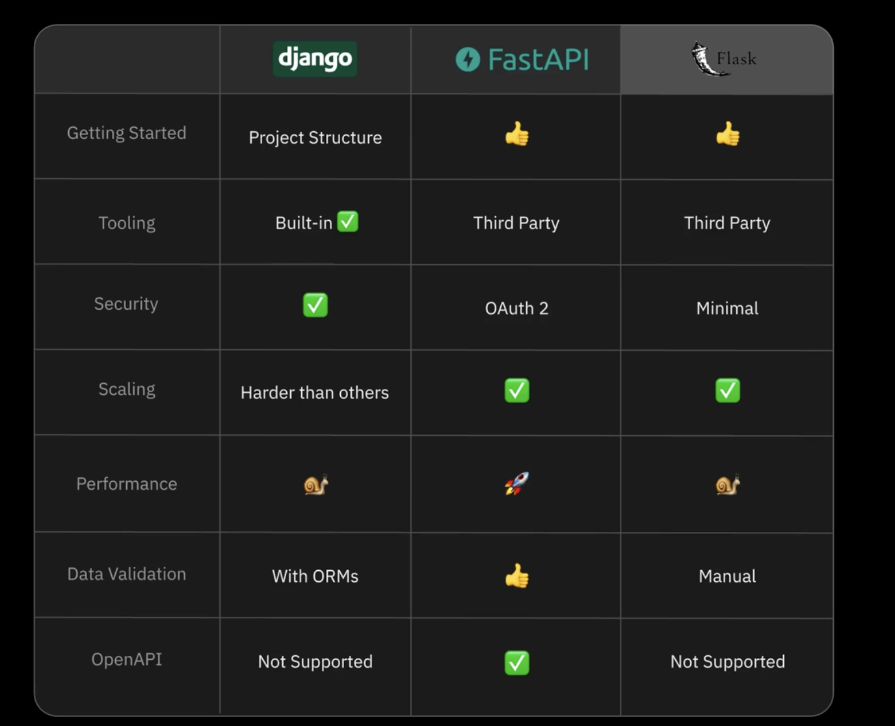

## HTTP Methods

1. `GET` Read data
2. `POST` Create new data
3. `PUT` Replace existing data
4. `DELETE` Remove data

## Response Status Code

- 2\*\* Success
- 3\*\* Redirection
- 4\*\* Client Side Error
- 5\*\* Server Side Error

## FastAPI example

```python
from fastapi import FastAPI

app = FastAPI()

@app.get("/shipment")
def read_shipment(id: int):
  return {
    "id": id,
    "status": "delivered"
  }
```

Run the server and it is ready to serve the requests.

## Dependencies

FastAPI depends on two other libraries

1. Starlette for webservers
2. Pydantic for handling data validation

## Comparison with Flask and Django



## API Documentation

You will notice when you start server with `fastapi dev` command you get two URLs:

> http://127.0.0.1:8000
> http://127.0.0.1:8000/docs

FastAPI takes our endpoint and creates an openapi specification for you automatically and uses swagger ui for documentation.
